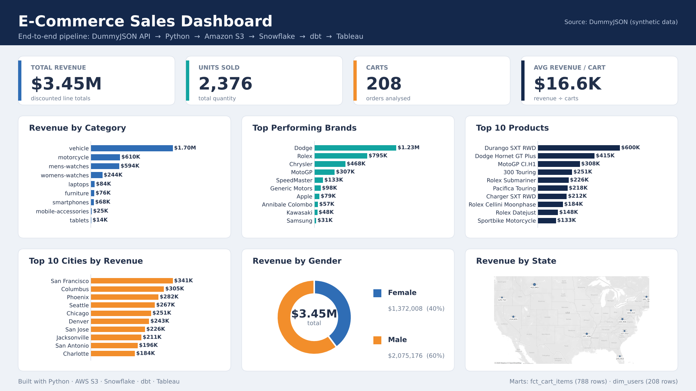
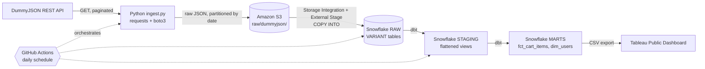
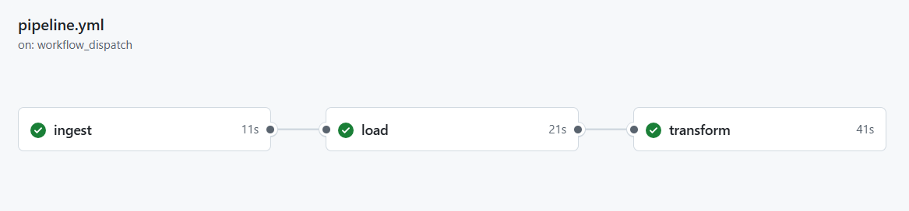

# DummyJSON End-to-End Data Pipeline

An ELT pipeline that ingests e-commerce data from a REST API, lands it as raw JSON in Amazon S3, loads it into Snowflake, models it with dbt, and visualizes it in a Tableau dashboard. The whole flow is orchestrated with GitHub Actions.



## Architecture



| Layer | Tool | Purpose |
|---|---|---|
| Source | DummyJSON REST API | Products, users and carts (no API key needed) |
| Ingestion | Python (`requests`, `boto3`) | Paginates through the API and writes raw JSON to S3 |
| Data lake | Amazon S3 | Raw, immutable landing zone, partitioned as `dt=YYYY-MM-DD` |
| Access control | AWS IAM + Snowflake Storage Integration | Role-based, key-less access from Snowflake to S3 |
| Warehouse | Snowflake | `RAW` (VARIANT), `STAGING` (views), `MARTS` (tables) |
| Transformation | dbt (dbt-snowflake) | Flattens nested JSON with `LATERAL FLATTEN`, dedupes, builds marts |
| Authentication | Key-pair (RSA) | dbt and the load script connect to Snowflake without a password |
| Orchestration | GitHub Actions | Runs ingest, load and transform in order, daily or on demand |
| Visualization | Tableau Public | KPIs and charts on the marts data |

## Orchestration

The workflow in `.github/workflows/pipeline.yml` runs three dependent jobs:




```
ingest (API -> S3)  ->  load (COPY INTO Snowflake)  ->  transform (dbt run)
```

It runs daily at 05:00 UTC and can also be started manually from the **Actions** tab. Credentials are stored as encrypted GitHub Secrets and never appear in the code.

## Data model

**Raw (Snowflake `RAW`)**: `raw_products`, `raw_users`, `raw_carts`, each with a `VARIANT` column plus `_source_file` and `_loaded_at` metadata.

**Staging (dbt views)**: `stg_products`, `stg_product_reviews`, `stg_users`, `stg_carts`, `stg_cart_items`. Nested arrays (reviews, cart products) are flattened into rows, and `QUALIFY ROW_NUMBER()` keeps only the latest copy of each record, so reloads never create duplicates.

**Marts (dbt tables)**:
- `fct_cart_items`: one row per product line in a cart, joined to cart and product attributes (788 rows)
- `dim_users`: customer dimension (208 rows)

## Project structure

```
dummyjson-data-pipeline/
├── .github/workflows/pipeline.yml   # GitHub Actions orchestration
├── ci/profiles.yml                  # dbt profile for CI (reads env vars, no secrets)
├── ingest.py                        # API -> S3
├── load_to_snowflake.py             # S3 -> Snowflake RAW (COPY INTO)
├── export_marts.py                  # Snowflake marts -> CSV (for Tableau Public)
├── sql/01_snowflake_setup.sql       # One-time Snowflake setup
├── dummyjson_dbt/
│   ├── dbt_project.yml
│   ├── macros/generate_schema_name.sql
│   └── models/
│       ├── staging/                 # _sources.yml + 5 staging models
│       └── marts/                   # fct_cart_items, dim_users
├── images/dashboard.png
└── README.md
```

## How to run locally

**Prerequisites:** Python 3.10+, an AWS account, a Snowflake account, AWS CLI configured.

```bash
# 1. Environment
python -m venv venv
venv\Scripts\activate          # macOS/Linux: source venv/bin/activate
pip install requests boto3 dbt-snowflake pandas

# 2. Ingest API data to S3
python ingest.py

# 3. One-time Snowflake setup: run sql/01_snowflake_setup.sql
#    (then update the AWS role trust policy with the integration's ARN and external ID)

# 4. Build the models
cd dummyjson_dbt
dbt debug
dbt run

# 5. Export marts for Tableau Public
cd ..
python export_marts.py
```

## GitHub Actions secrets

Add these under **Settings > Secrets and variables > Actions**:

| Secret | Purpose |
|---|---|
| `AWS_ACCESS_KEY_ID`, `AWS_SECRET_ACCESS_KEY` | Write access to the S3 bucket for ingestion |
| `SNOWFLAKE_ACCOUNT` | Snowflake account identifier |
| `SNOWFLAKE_USER` | Snowflake user for key-pair login |
| `SNOWFLAKE_PRIVATE_KEY` | Contents of the RSA private key (PEM) |

## Key design decisions

- **ELT, not ETL:** raw JSON is preserved in S3 and Snowflake, and transformation happens in the warehouse with dbt.
- **Idempotent loads:** `COPY INTO` tracks loaded files, and dbt deduplicates on business keys.
- **Rebuildable warehouse:** because raw data lives in S3, the Snowflake side can be recreated from `sql/01_snowflake_setup.sql` (this was done once after a trial account expired).
- **No secrets in code or git:** credentials live in `~/.aws`, GitHub Secrets and key-pair auth, and `.gitignore` excludes `*.p8`, `*.pub` and `*.csv`.
- **Least privilege:** the ingest user can only write to one bucket, and Snowflake reads through a dedicated read-only IAM role.

## Dashboard

Built in Tableau Public from the marts layer: KPIs (total revenue, quantity, carts, average revenue per cart), revenue by category, top brands, top products, top cities, revenue by gender and revenue by state.

## Future improvements

- Move orchestration to Airflow (it was tested locally but needs more RAM than a 4 GB laptop provides)
- Add dbt tests (`unique`, `not_null`) and source freshness checks
- Replace the CSV export with a live Snowflake connection in Tableau or Power BI
- Use a dedicated, least-privilege Snowflake role for dbt instead of `ACCOUNTADMIN`

## Tech stack

Python · Amazon S3 · AWS IAM · Snowflake · dbt · SQL · GitHub Actions · Tableau
